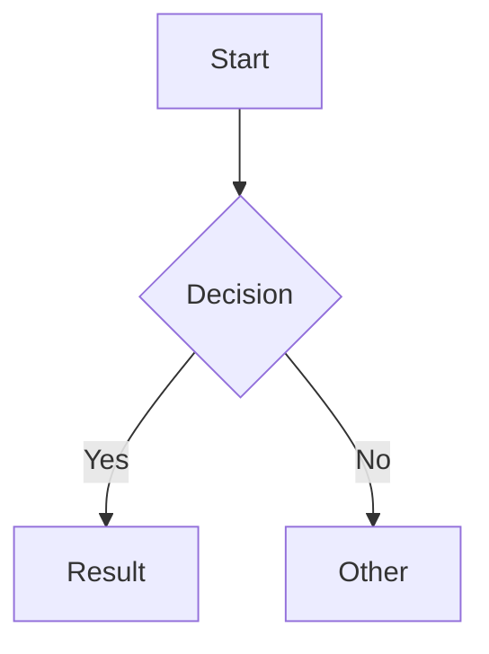
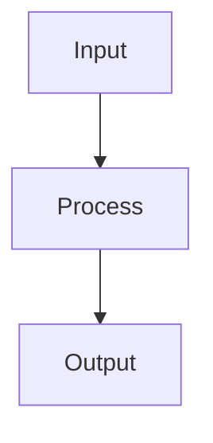

# Markdown Authoring Rules

When generating `.md` files, follow these rules. They define what Markdown
features to use, what to avoid, and how to structure content so it renders
correctly and exports cleanly to PDF.

---

## Text & Structure

- Use all six heading levels (`#` through `######`) to organize content.
- Use `**bold**`, `*italic*`, `***bold+italic***`, and `~~strikethrough~~`.
- Use inline code with backticks and fenced code blocks with a language tag
  (e.g., `` ```python ``). Code blocks have no syntax highlighting — they
  receive uniform styling — so do not rely on color to convey meaning in code.
- Use horizontal rules (`---`) to separate sections.
- A single newline inside a paragraph produces a line break. Two trailing
  spaces also force a line break.

## Headings

- Every document should start with a single `# H1` title.
- Use headings hierarchically — don't skip levels.
- Headings are used to auto-generate a navigable Table of Contents.

## Lists

- Ordered (`1.`), unordered (`-`), and nested lists.
- GitHub-style task lists: `- [x] done` / `- [ ] todo`.

## Links & Images

- Inline and reference-style links. Bare URLs are auto-linked.
- Images: ``
  - Relative paths resolve from the `.md` file's directory.
  - Absolute file paths, `file://`, `http://`, `https://`, and `data:` URIs
    all work.
  - Supported formats: **PNG, JPG, GIF, WebP, SVG**.
  - Keep image width under **186 mm** (~7.3 in) to fit an A4 printable area.
    Larger images are scaled down but may lose detail.

## Tables

- Standard pipe tables with column alignment (`:---`, `:---:`, `---:`).
- Math expressions work inside table cells.
- Keep tables narrow enough to fit the page — very wide tables overflow in PDF.
  Split wide data across multiple tables when needed.

## Blockquotes

- Standard `>` blockquotes, including nested (`> >`).

## Inline HTML

Use these safely:

```
<div>  <span>  <details>  <summary>  <table>    <br>
<sup>  <sub>  <mark>  <kbd>  <abbr>  <p>  <ul>  <ol>  <li>
```

- `style` and `class` attributes are preserved.
- **Never use**: `<script>`, `onclick`/`onerror` handlers, or `javascript:`
  URLs — they are stripped.

## Math (LaTeX)

- **Inline**: `$E = mc^2$` or `\(E = mc^2\)`
- **Display**: `$$\int_0^\infty e^{-x}\,dx = 1$$` or `\[...\]`
- **Fenced block**: triple backticks with language `math`
- Available LaTeX packages: **ams**, **mathtools**, **color**, **cancel**,
  **bbox**, **mhchem** (chemistry), **physics**
- Custom macros can be declared in YAML front matter:

```yaml
---
macros:
  RR: '{\mathbb{R}}'
  NN: '{\mathbb{N}}'
---
```

## Diagrams

### Mermaid

Use fenced code blocks with language `mermaid`:

````

````

Supported diagram types: flowchart, sequence, class, state, Gantt, git graph,
pie chart.

Keep diagram height under approximately **220 mm** — taller diagrams are
clipped in PDF. Break complex diagrams into smaller ones.

### Draw.io

Fenced XML code blocks containing `<mxGraphModel>` are rendered as inline SVG
diagrams automatically.

### UML Sequence Diagrams

Fenced code blocks with language `uml-sequence-diagram` are supported.

### SVG

- Inline `<svg>` elements work directly.
- Fenced code blocks with language `svg`, `xml`, or `html` that contain a
  standalone SVG element are unwrapped and rendered inline.

## Typographic Replacements

These happen automatically — do not escape them unless you want the literal
characters:

| You type | Rendered as |
|----------|-------------|
| `"text"` | "text" (curly quotes) |
| `'text'` | 'text' (curly quotes) |
| `--` | en-dash (–) |
| `---` | em-dash (—) |
| `...` | ellipsis (…) |

---

## Do NOT Use These Features

They will render as raw text or be silently ignored:

| Feature | What to do instead |
|---------|--------------------|
| Footnotes (`[^1]`, `[^note]`) | Use parenthetical inline references |
| Definition lists (`Term` / `: Definition`) | Use a bold term followed by a paragraph, or a table |
| Emoji shortcodes (`:smile:`, `:rocket:`) | Use Unicode emoji directly: 😄 🚀 ✅ ⚠️ |
| Abbreviation definitions (`*[HTML]: ...`) | Spell out the term on first use instead |
| `[toc]` or `[[toc]]` directives | Omit — the viewer builds a TOC from headings automatically |
| Admonition blocks (`:::warning`, `:::note`) | Use a blockquote with a bold label: `> **Warning:** ...` |

---

## PDF & Print Guidelines

- Default page: **A4 portrait** (210 x 297 mm) with ~15 mm top/bottom and
  ~12 mm left/right margins.
- **Code blocks** wrap long lines automatically in PDF. Keep lines under
  ~100 characters for best readability.
- **Headings** stay attached to the content that follows them — they won't
  appear alone at the bottom of a page.
- **Code blocks, images, blockquotes, and diagrams** avoid splitting across
  pages. Very long code blocks or tall diagrams may be clipped — break them
  up.
- **Tables** repeat their header row on each page.
- **Paragraphs** keep at least 3 lines together at page top and bottom
  (orphan/widow control).
- Avoid diagrams taller than a full page and deeply nested HTML structures.

---

## Document Template

```markdown
---
macros:
  RR: '{\mathbb{R}}'
---

# Document Title

## Introduction

A paragraph with **bold**, *italic*, and `inline code`.

The energy-mass relation: $E = mc^2$

$$
\int_0^\infty e^{-x}\,dx = 1
$$

## Data

| Column A | Column B | Column C |
|:---------|:--------:|---------:|
| Left     | Center   | Right    |

## Steps

1. First step
2. Second step
   - Sub-detail

- [x] Completed task
- [ ] Pending task

## Architecture



## Notes

> A blockquote for callouts or asides.

<details>
<summary>Click to expand</summary>

Hidden detail content.

</details>
```

---

## Quick Reference

| What you want | Syntax |
|---------------|--------|
| Inline math | `$x^2 + y^2$` |
| Display math | `$$\sum_{i=1}^n i = \frac{n(n+1)}{2}$$` |
| Chemistry | `$\ce{2H2 + O2 -> 2H2O}$` |
| Physics vectors | `$\va{F} = m\va{a}$` |
| Mermaid diagram | `` ```mermaid `` |
| Draw.io diagram | Fenced XML with `<mxGraphModel>` |
| Task list | `- [x] Done` / `- [ ] Todo` |
| Collapsible section | `<details><summary>Title</summary>content</details>` |
| Emoji | Unicode directly: 🚀 ✅ ⚠️ 📝 |
| Line break | Single newline, or two trailing spaces |
